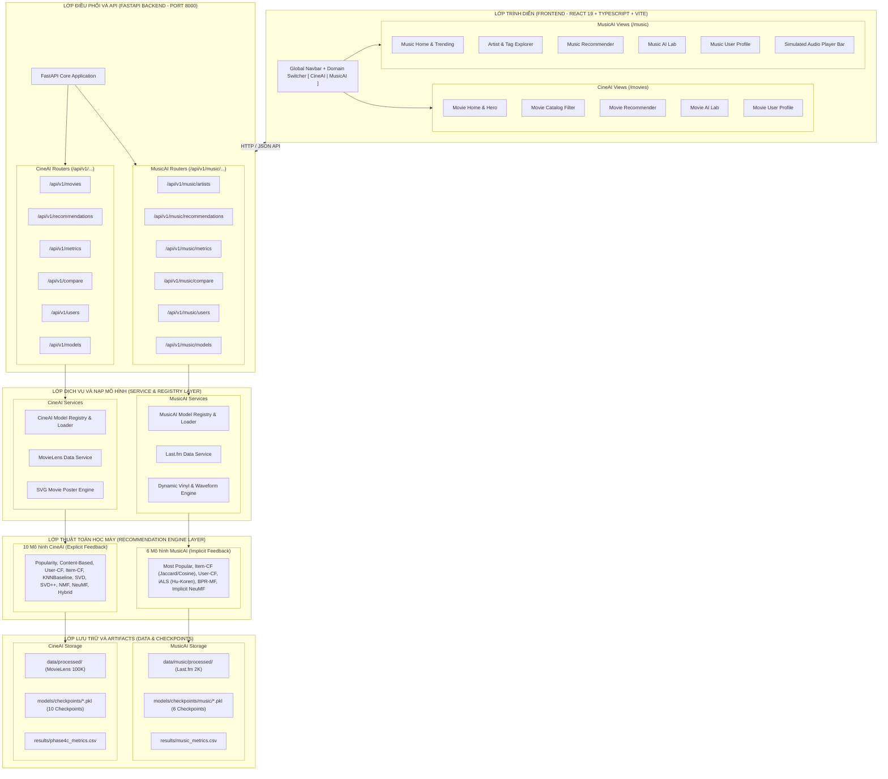

# KIẾN TRÚC HỆ THỐNG ĐA MIỀN (MULTI-DOMAIN ARCHITECTURE)
## PHASE M0: SYSTEM DESIGN & DOMAIN DECOUPLING SPECIFICATION

**Dự án:** Multi-Domain AI Recommendation Platform  
**Hai miền nghiệp vụ:** **CineAI** (Điện ảnh) & **MusicAI** (Âm nhạc)  
**Trạng thái kiến trúc:** ĐÃ THIẾT KẾ & THẨM ĐỊNH KHẢ THI (CERTIFIED BLUEPRINT)  
**Tác giả:** Senior Full-Stack Software Architect & Recommender Systems Specialist  
**Ngày:** 28/10/2026  

---

## 1. TẦM NHÌN VÀ NGUYÊN TẮC THIẾT KẾ KIẾN TRÚC

Việc mở rộng dự án từ nền tảng đơn miền (CineAI) sang nền tảng đa miền (CineAI + MusicAI) tuân thủ 4 nguyên tắc kỹ thuật cốt lõi:

1. **Nguyên tắc Độc lập Miền (Domain Isolation / Bounded Contexts):**
   Mỗi miền (CineAI, MusicAI) sở hữu toàn vẹn và độc lập về: dữ liệu thô, dữ liệu tiền xử lý, thuật toán mô hình, trọng số checkpoints, router API và trang hiển thị người dùng.
2. **Nguyên tắc Tương thích Ngược Tuyệt đối (Zero-Regression & Backward Compatibility):**
   Mọi endpoint, dữ liệu và giao diện hiện có của CineAI giữ nguyên vẹn 100%. Không có bất kỳ thay đổi nào làm gãy vỡ các bài kiểm thử hoặc hợp đồng API đã cam kết tại Phase 6A.
3. **Nguyên tắc Tái sử dụng Tối đa Thành phần Nền tảng (Platform Reuse):**
   Tái sử dụng chung hạ tầng API (FastAPI base app, CORS, error handling, health check), công thức tính toán độ đo Top-N chuẩn tắc (`src/evaluation/metrics.py`), và ngôn ngữ thiết kế giao diện (Design System, Dark Theme, Tailwind CSS v4, component primitives).
4. **Nguyên tắc Thống nhất Trải nghiệm Người dùng (Unified User Experience):**
   Người dùng có thể chuyển đổi mượt mà giữa hai miền chỉ với 1 cú click chuột thông qua **Bộ chuyển đổi miền (Domain Switcher)** trên thanh điều hướng chính (Navbar).

---

## 2. KIẾN TRÚC TỔNG THỂ HỆ THỐNG (SYSTEM ARCHITECTURE DIAGRAM)

Dưới đây là sơ đồ kiến trúc đa tầng thể hiện sự phân tách rành mạch giữa CineAI và MusicAI:



---

## 3. CƠ CẤU THƯ MỤC VÀ KHÔNG GIAN TÊN DỰ ÁN (DIRECTORY LAYOUT)

Cấu trúc cây thư mục được phân định rõ ràng nhằm ngăn chặn triệt để sự pha tạp mã nguồn:

```text
AI-Recommendation-System/
├── backend/
│   └── app/
│       ├── main.py                     # Entry point khởi động FastAPI
│       ├── core/
│       │   └── config.py               # Cấu hình đa miền (đường dẫn, CORS, metadata)
│       ├── api/
│       │   └── v1/
│       │       ├── health.py           # Shared health check
│       │       ├── movies.py           # [CineAI] Phim ảnh
│       │       ├── recommendations.py  # [CineAI] Gợi ý phim (legacy router)
│       │       ├── metrics.py          # [CineAI] Bảng đo lường phim
│       │       ├── compare.py          # [CineAI] So sánh mô hình phim
│       │       ├── models.py           # [CineAI] Danh sách 10 mô hình phim
│       │       ├── users.py            # [CineAI] Người dùng phim
│       │       └── music/              # [MusicAI - Isolated Namespace]
│       │           ├── __init__.py
│       │           ├── artists.py      # Tra cứu nghệ sĩ, thẻ tag
│       │           ├── recommendations.py # Gợi ý nghệ sĩ / bài hát ngầm định
│       │           ├── metrics.py      # Bảng đo lường mô hình âm nhạc
│       │           ├── compare.py      # So sánh đối đầu mô hình âm nhạc
│       │           ├── models.py       # Danh sách các mô hình MusicAI
│       │           └── users.py        # Lịch sử nghe và tương tác người dùng
│       ├── schemas/
│       │   ├── movie.py                # Pydantic schemas CineAI
│       │   ├── recommendation.py
│       │   └── music/                  # Pydantic schemas MusicAI
│       │       ├── artist.py
│       │       ├── recommendation.py
│       │       └── metrics.py
│       └── services/
│           ├── movie_service.py        # [CineAI]
│           ├── model_service.py        # [CineAI]
│           └── music/                  # [MusicAI Service Layer]
│               ├── music_service.py
│               ├── music_model_service.py
│               └── music_cover_service.py
├── frontend/
│   └── src/
│       ├── components/
│       │   ├── common/                 # UI Primitives dùng chung
│       │   │   ├── Navbar.tsx          # Thanh điều hướng với Domain Switcher
│       │   │   ├── DomainSwitcher.tsx  # Nút gạt chuyển đổi [CineAI | MusicAI]
│       │   │   ├── Button.tsx
│       │   │   ├── Modal.tsx
│       │   │   └── Card.tsx
│       │   ├── movies/                 # Giao diện đặc thù CineAI
│       │   │   ├── MovieCard.tsx
│       │   │   └── MovieFilter.tsx
│       │   └── music/                  # Giao diện đặc thù MusicAI
│       │       ├── ArtistCard.tsx
│       │       ├── AudioPlayerBar.tsx  # Trình phát nhạc mô phỏng chân thực
│       │       ├── WaveformVisualizer.tsx # Hiệu ứng sóng âm
│       │       └── TagFilter.tsx
│       ├── pages/
│       │   ├── HomePage.tsx            # CineAI Home
│       │   ├── DiscoverPage.tsx        # CineAI Discover
│       │   ├── RecommendationsPage.tsx # CineAI Recs
│       │   ├── AILabPage.tsx           # CineAI AI Lab
│       │   ├── ProfilePage.tsx         # CineAI Profile
│       │   └── music/                  # MusicAI Pages
│       │       ├── MusicHomePage.tsx
│       │       ├── MusicDiscoverPage.tsx
│       │       ├── MusicRecommendationsPage.tsx
│       │       ├── MusicAILabPage.tsx
│       │       └── MusicProfilePage.tsx
│       ├── services/
│       │   ├── api.ts                  # CineAI API Client
│       │   └── musicApi.ts             # MusicAI API Client
│       └── types/
│           ├── index.ts                # CineAI TypeScript Types
│           └── music.ts                # MusicAI TypeScript Types
├── data/
│   ├── processed/                      # [CineAI] MovieLens 100K (Bất biến)
│   │   ├── movies_clean.csv
│   │   ├── train.csv
│   │   └── test.csv
│   └── music/                          # [MusicAI] Last.fm 2K (Độc lập)
│       ├── raw/
│       └── processed/
│           ├── artists_clean.csv
│           ├── train.csv
│           ├── val.csv
│           └── test.csv
├── models/
│   └── checkpoints/
│       ├── *.pkl                       # 10 Checkpoints của CineAI (Bất biến)
│       └── music/                      # Checkpoints riêng của MusicAI
│           ├── ials.pkl
│           ├── bpr.pkl
│           └── implicit_ncf.pkl
├── src/
│   ├── evaluation/
│   │   ├── metrics.py                  # Công thức đo lường chuẩn (Tái sử dụng chung)
│   │   ├── evaluator.py                # TopNEvaluator tường minh (CineAI)
│   │   └── music_evaluator.py          # ImplicitTopNEvaluator (MusicAI)
│   ├── models/                         # 10 Mô hình CineAI
│   └── music/                          # Mô hình MusicAI
│       ├── base_music_recommender.py
│       ├── ials.py
│       ├── bpr.py
│       └── implicit_neural_cf.py
└── docs/
    └── musicai/                        # Toàn bộ tài liệu thiết kế Phase M0-M6
```

---

## 4. CHI TIẾT THIẾT KẾ DOMAIN SWITCHER VÀ ĐIỀU HƯỚNG FRONTEND

### 4.1. Cơ chế Chuyển đổi Miền (Domain Switcher)

Trên thanh điều hướng `Navbar.tsx`, người dùng được cung cấp một nút bấm chuyển đổi dạng Pill Switcher với thiết kế hiện đại:

```text
+-----------------------------------------------------------------------------------------+
| [CineAI Logo]   (●) CineAI [Phim]   |   ( ) MusicAI [Nhạc]          Khám phá | Gợi ý ... |
+-----------------------------------------------------------------------------------------+
```

- Khi ở chế độ **CineAI**:
  - Tông màu chủ đạo: Đỏ điện ảnh Netflix (`#E50914`), nền đen xám than (`#141414`).
  - Đường dẫn URL: `/` (Home), `/discover`, `/recommendations`, `/ai-lab`, `/profile`.
  - Hiển thị poster phim, điểm đánh giá sao, năm phát hành, thể loại điện ảnh.
- Khi chuyển sang **MusicAI**:
  - Tông màu chủ đạo: Xanh ngọc lục bảo Spotify / Neon Violet (`#1DB954` / `#8B5CF6`).
  - Đường dẫn URL: `/music`, `/music/discover`, `/music/recommendations`, `/music/ai-lab`, `/music/profile`.
  - Hiển thị ảnh nghệ sĩ đĩa than (Vinyl Disc), số lượt nghe tích lũy (`play count`), danh sách tag/thể loại âm nhạc, và **Trình phát nhạc chân thực (Simulated Audio Player Bar)** ở chân trang.

### 4.2. Trình phát nhạc mô phỏng chân thực (Simulated Audio Player Bar)

Khi người dùng duyệt các bài hát hoặc nghệ sĩ trong MusicAI, một thanh điều khiển cố định ở đáy màn hình (Bottom Sticky Bar) sẽ xuất hiện:
- Hiển thị tên nghệ sĩ, bài hát đang chọn và ảnh bìa thu nhỏ dạng đĩa than đang xoay tròn.
- Trình diễn dạng sóng âm sống động (**Waveform Visualizer**) bằng canvas/SVG mô phỏng tần số âm thanh.
- Bộ nút điều khiển: Play/Pause, tua tiến/lùi 5 giây, thanh trượt âm lượng và bộ đếm thời gian (0:00 / 0:30).
- Hoạt động bằng mã JavaScript thuần và web audio synthesizer hoặc âm thanh chime ngắn không bản quyền, bảo đảm không vi phạm bản quyền phát thanh nhạc số.

---

## 5. THIẾT KẾ GIAO TIẾP VÀ AN TOÀN API (FASTAPI BACKEND DESIGN)

1. **Phân nhánh Router rõ ràng:**
   - CineAI routers: tiếp tục lắng nghe tại `/api/v1/movies`, `/api/v1/recommendations`, `/api/v1/models` như cũ.
   - MusicAI routers: gắn kết tại tiền tố `/api/v1/music/` (`/artists`, `/recommendations`, `/models`, `/metrics`, `/compare`).
2. **Quản lý Vòng đời Checkpoint (Lazy-Loading Memory Management):**
   - Các mô hình chỉ được nạp vào RAM khi có yêu cầu dự đoán đầu tiên (Lazy Loading), giúp duy trì mức tiêu thụ RAM backend dưới 400 MB khi khởi động.
   - Cơ chế bộ đệm thông minh (`cached_models`) lưu trữ mô hình sau khi nạp để phục vụ các yêu cầu tiếp theo trong thời gian thực (< 15ms phản hồi).

---

## 6. KẾT LUẬN

Kiến trúc đa miền được thiết kế theo phương châm **"Tách biệt hoàn toàn về dữ liệu và nghiệp vụ - Hợp nhất tinh tế tại cổng giao tiếp và giao diện"**. Bản thiết kế này loại bỏ 100% nguy cơ lan truyền lỗi (error propagation) sang CineAI, mở đường cho việc triển khai suôn sẻ các giai đoạn tiếp theo.
