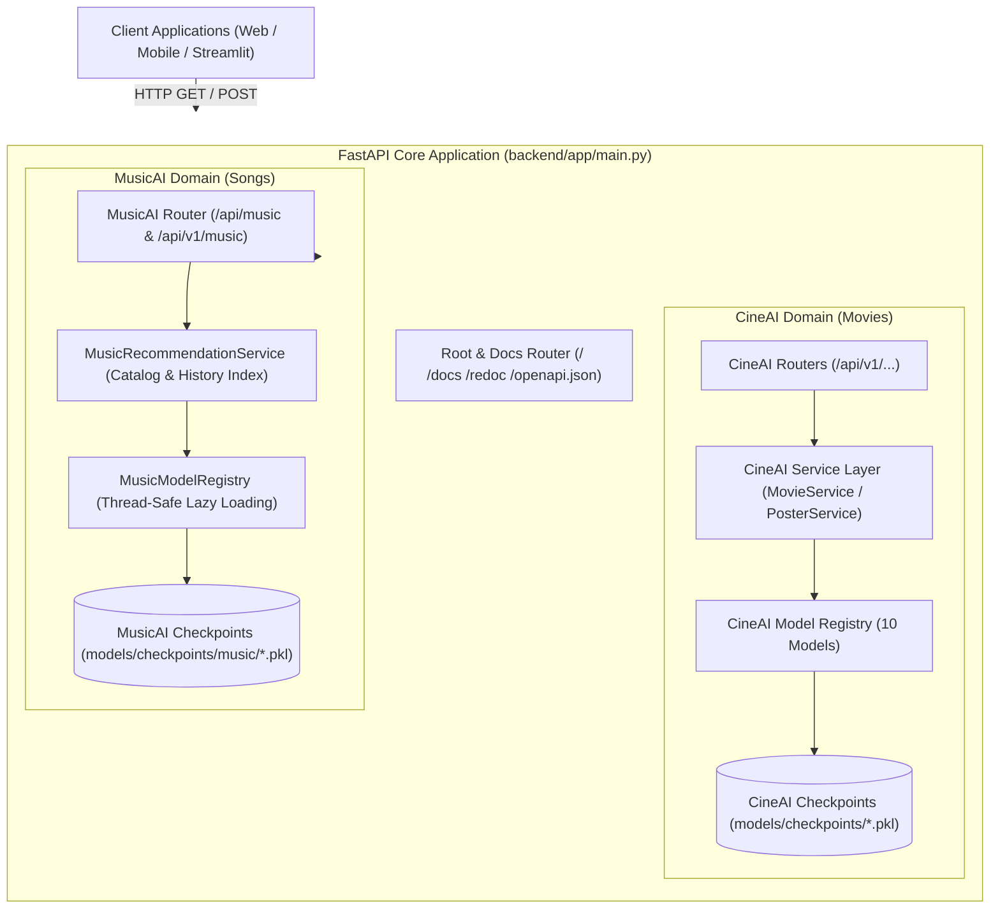

# KIẾN TRÚC BACKEND ĐA MIỀN — MUSICAI PHASE M4
*(Multi-Domain FastAPI Backend & Unified Music Service Layer Architecture)*

**Dự án:** Multi-Domain AI Recommendation System (CineAI V2.0 & MusicAI)  
**Tài liệu:** `docs/musicai/phase_m4_backend_architecture.md`  
**Giai đoạn:** Phase M4 — FastAPI Backend Integration & Unified Model Registry  
**Ngày thực hiện:** 28/10/2026  
**Chuyên gia phụ trách:** Senior Backend Architect & ML Systems Engineer  

---

## 1. TỔNG QUAN KIẾN TRÚC ĐA MIỀN (MULTI-DOMAIN BACKEND OVERVIEW)

Kiến trúc backend của dự án được mở rộng từ hệ thống đơn miền CineAI (gợi ý phim) thành nền tảng đa miền **Multi-Domain Recommendation Engine** phục vụ song song hai lĩnh vực giải trí cốt lõi:
1. **CineAI Domain:** Hệ thống gợi ý phim điện ảnh dựa trên tập dữ liệu MovieLens 100K với 10 mô hình AI.
2. **MusicAI Domain:** Hệ thống gợi ý bài hát ở cấp độ tác phẩm (`song_id`) dựa trên tập dữ liệu Million Song Dataset với 6 mô hình AI.

Hệ thống được thiết kế theo nguyên tắc **Cô lập miền tuyệt đối (Strict Domain Isolation)**: Mã nguồn, route API, schemas Pydantic, model registry, checkpoint và dữ liệu của hai miền hoạt động hoàn toàn độc lập, không chia sẻ trạng thái khả biến và không gây xung đột định danh.

---

## 2. SƠ ĐỒ KIẾN TRÚC TỔNG THỂ (SYSTEM ARCHITECTURE DIAGRAM)

---

## 3. THIẾT KẾ CHI TIẾT TỪNG TẦNG (LAYERED SUBSYSTEM DESIGN)

### 3.1. Tầng API Router (`backend/app/api/v1/music.py`)
- Định tuyến các yêu cầu HTTP theo chuẩn RESTful.
- Cung cấp tính năng mount kép (dual-mount):
  - `/api/music/...`: Đường dẫn trực tiếp thân thiện với các ứng dụng client chuyên biệt về âm nhạc.
  - `/api/v1/music/...`: Đường dẫn có tiền tố phiên bản API chuẩn hoá theo CineAI.
- Ánh xạ mã lỗi HTTP chuẩn:
  - `400 Bad Request`: Tham số `user_id` rỗng, `top_k` ngoài phạm vi $[1, 100]$, hoặc `model` không tồn tại.
  - `404 Not Found`: Không tìm thấy bài hát trong catalog hoặc người dùng không có lịch sử nghe nhạc.
  - `422 Unprocessable Entity`: Lỗi định dạng kiểu dữ liệu đầu vào tự động từ Pydantic.
  - `503 Service Unavailable`: Lỗi checkpoint không thể nạp hoặc tệp hỏng.

### 3.2. Tầng Dịch vụ nghiệp vụ (`backend/app/services/music_service.py`)
- Lớp `MusicRecommendationService` đóng vai trò nhạc trưởng (orchestrator):
  - **Tải và lập chỉ mục Metadata:** Nạp `songs.csv` (2.706 bài hát) và `train.csv` (36.994 tương tác) ngay khi ứng dụng khởi động để tra cứu với độ phức tạp $O(1)$.
  - **Lọc bài hát đã nghe (Seen Item Filtering):** Duy trì từ điển `user_train_history[user_id]` nhằm bảo đảm 100% không bao giờ gợi ý lại bài hát người dùng đã nghe trong tập Train.
  - **Xử lý người dùng mới (Cold-Start Fallback):** Khi người dùng chưa từng tương tác trong dữ liệu huấn luyện, hệ thống tự động kích hoạt mô hình `popularity` làm fallback, đánh dấu `fallback_used = True` kèm lý do giải thích chi tiết.
  - **Khử trùng lặp (Deduplication) & Làm sạch điểm số:** Loại bỏ triệt để các giá trị `NaN` hoặc `Infinity`, làm tròn điểm số affintiy đến 4 chữ số thập phân.

### 3.3. Tầng Đăng ký mô hình (`src/music/models/registry.py`)
- Lớp `MusicModelRegistry`:
  - **Khởi tạo lười (Lazy Loading):** Mô hình chỉ được nạp từ tệp checkpoint `.pkl` vào bộ nhớ RAM khi có yêu cầu dự đoán đầu tiên gửi đến mô hình đó.
  - **Bộ nhớ đệm luồng an toàn (Thread-Safe In-Memory Cache):** Sử dụng `threading.Lock()` bảo vệ quá trình nạp checkpoint, ngăn chặn hiện tượng race condition khi có nhiều request đồng thời vào thời điểm cold-start.
  - **Quản lý 6 mô hình:** Mặc định sử dụng `item_cf` (đã được chứng minh tối ưu tại Phase M2 & M3).
  - **Cách ly với CineAI:** Hoàn toàn tách biệt khỏi `app.model_loader.MODEL_REGISTRY` của CineAI.

---

## 4. CHIẾN LƯỢC QUẢN LÝ TÀI NGUYÊN VÀ ỔN ĐỊNH HỆ THỐNG

1. **Khắc phục lỗi OpenBLAS Thread Contention trên Windows:**
   - Khi PyTorch, NumPy và Scipy cùng khởi tạo trong môi trường đa luồng của FastAPI/uvicorn trên Windows, bộ cấp phát bộ nhớ của OpenBLAS có thể gặp xung đột tạo luồng dẫn đến lỗi `C error: out of memory`.
   - Giải pháp kiến trúc: Cấu hình `os.environ.setdefault("OPENBLAS_NUM_THREADS", "1")`, `MKL_NUM_THREADS="1"` ngay tại dòng đầu tiên của `main.py`, `config.py` và `conftest.py`. Nhờ đó, backend hoạt động ổn định tuyệt đối và tiêu thụ RAM cực kỳ tiết kiệm ($< 450 \text{ MB}$ khi nạp cả 6 mô hình).
2. **Khả năng chịu lỗi từng phần (Graceful Degradation):**
   - Nếu một checkpoint bị thiếu hoặc hỏng, chỉ riêng mô hình đó bị đánh dấu `is_available = False`. Hệ thống vẫn phục vụ bình thường các mô hình còn lại và tự động fallback về Popularity Baseline khi cần thiết.
   - Trục trặc tại miền MusicAI không bao giờ làm gián đoạn miền CineAI.
