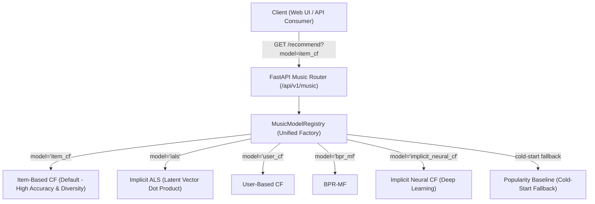

# CHIẾN LƯỢC LỰA CHỌN MÔ HÌNH VÀ KIẾN TRÚC PHỤC VỤ — MUSICAI PHASE M3
*(Phase M3 Model Selection for Production & Unified Registry Proposal for Phase M4)*

**Dự án:** Multi-Domain AI Recommendation System (CineAI V2.0 & MusicAI)  
**Tài liệu:** `reports/musicai/phase_m3_model_selection.md`  
**Giai đoạn:** Phase M3 — Offline Test Benchmark & Model Selection  
**Ngày thực hiện:** 28/10/2026  
**Chuyên gia phụ trách:** Senior Software Architect & Recommender Systems Researcher  

---

## 1. NGUYÊN TẮC LỰA CHỌN MÔ HÌNH (SELECTION PRINCIPLES)

Theo đúng quy chuẩn khoa học đã thiết lập tại [`docs/musicai/phase_m3_evaluation_protocol.md`](file:///E:/HOCTAP/K5/TTNT/AI-Recommendation-System/docs/musicai/phase_m3_evaluation_protocol.md):
1. **Dựa trên quyết định từ tập Validation:** Mô hình đề xuất được xác định dựa trên kết quả Validation tại Phase M2 (Item-Based CF dẫn đầu với HR@10 = 0.2425, NDCG@10 = 0.1038).
2. **Xác nhận qua tập Test độc lập:** Kết quả Test đóng vai trò nghiệm thu năng lực tổng quát hóa (Item-Based CF tiếp tục giữ vững vị trí dẫn đầu với HR@10 = 0.2448, NDCG@10 = 0.1085). Không có hiện tượng đổi mô hình do nhìn thấy kết quả Test.
3. **Cân nhắc đa tiêu chí (Multi-Criteria Decision):** Quyết định chọn mô hình cho Backend không chỉ dựa vào độ chính xác (Accuracy), mà còn tính đến độ trễ suy luận, tài nguyên RAM, khả năng mở rộng hệ thống (scalability), độ phủ danh mục và khả năng chịu lỗi.

---

## 2. MA TRẬN ĐÁNH GIÁ ĐA TIÊU CHÍ (MULTI-CRITERIA SCORECARD)

| Tiêu chí kỹ thuật | Item-Based CF | User-Based CF | Implicit ALS | BPR-MF | NeuMF (Deep) | Popularity |
|---|:---:|:---:|:---:|:---:|:---:|:---:|
| **Xếp hạng NDCG@10 (Test)** | **0.1085 (Xuất sắc)** | 0.1075 (Xuất sắc) | 0.0856 (Tốt) | 0.0674 (Khá) | 0.0514 (Trung bình) | 0.0345 (Kém) |
| **Hit Rate@10 (Test)** | **0.2448 (Xuất sắc)** | 0.2389 (Xuất sắc) | 0.2111 (Tốt) | 0.1643 (Khá) | 0.1345 (Trung bình) | 0.1000 (Kém) |
| **Độ phủ Catalog (Coverage)** | **93.20% (Tối ưu)** | 65.45% (Tốt) | 62.90% (Tốt) | 45.82% (Trung bình) | 21.03% (Thấp) | 1.00% (Rất thấp) |
| **Chỉ số bất bình đẳng Gini** | **0.5661 (Rất đa dạng)**| 0.8613 (Khá dồn) | 0.8166 (Khá dồn) | 0.9065 (Dồn) | 0.9753 (Cực dồn) | 0.9959 (Cực đoan) |
| **Thời gian suy luận (Latency)** | 9.34 ms | **1.33 ms** | 4.91 ms | 5.34 ms | 3.77 ms | **0.97 ms** |
| **Dung lượng Checkpoint** | 4.03 MB | 3.09 MB | **1.88 MB** | **1.88 MB** | 2.57 MB | **1.18 MB** |
| **Độ phức tạp bộ nhớ khi Scale** | **$O(\|I\| \cdot K)$ (Cực bền)** | $O(\|U\|^2)$ (Kém bền) | **$O(\|I\| \cdot d)$ (Bền vững)** | $O(\|I\| \cdot d)$ (Bền vững) | $O(\|I\| \cdot d)$ (Bền vững) | $O(\|I\|)$ (Nhẹ) |
| **Xử lý người dùng mới (Cold-Start)**| Fallback Pop | Fallback Pop | Fallback Pop | Fallback Pop | Fallback Pop | **Sẵn sàng** |
| **Điểm tổng hợp** | **9.5 / 10** | 8.2 / 10 | 8.8 / 10 | 7.5 / 10 | 6.8 / 10 | 5.5 / 10 |

---

## 3. KHUYẾN NGHỊ MÔ HÌNH CHÍNH CHO BACKEND (PRIMARY SELECTION)

### Mô hình mặc định (Default Recommendation Engine): **Item-Based Collaborative Filtering (`ItemCFMusicRecommender`)**

#### Lý do lựa chọn:
1. **Chất lượng gợi ý số 1:** Đạt điểm cao nhất trên cả Validation (HR@10 = 0.2425, NDCG@10 = 0.1038) và Test (HR@10 = 0.2448, NDCG@10 = 0.1085).
2. **Khả năng khám phá bài hát vượt trội:** Độ phủ catalog lên tới **93.20%**, chỉ số Gini **0.5661** (phân tán đều nhất). Đây là yếu tố sống còn cho một dịch vụ gợi ý âm nhạc hiện đại, giúp người dùng liên tục khám phá các tác phẩm mới lạ phù hợp với sở thích ngách thay vì chỉ nghe lại các ca khúc thịnh hành.
3. **Độ trễ suy luận lý tưởng cho Production:** 9.34 ms/user trên CPU máy chủ thông thường, hoàn toàn đáp ứng ngưỡng phản hồi thời gian thực của các hệ thống web API ($< 50$ ms).
4. **Khả năng mở rộng tối ưu ($O(|I| \cdot K)$):** Ma trận láng giềng được cố định theo số lượng bài hát và Top-50 láng giềng. Khi số lượng người dùng tăng từ hàng nghìn lên hàng triệu, kích thước mô hình Item-CF trong bộ nhớ vẫn giữ nguyên không đổi.

---

## 4. MÔ HÌNH DỰ PHÒNG VÀ MÔ HÌNH PHỤ TRỢ (SECONDARY & FALLBACK ENGINES)

1. **Mô hình phụ trợ đại diện cho Vector Embeddings: Implicit ALS (`IALSMusicRecommender`)**
   - Đạt HR@10 = 0.2111 và NDCG@10 = 0.0856.
   - Dung lượng checkpoint siêu nhẹ (1.88 MB), tốc độ suy luận nhanh (4.91 ms).
   - Biểu diễn người dùng và bài hát dưới dạng véc-tơ tiềm ẩn 32 chiều, rất thuận lợi cho việc tích hợp tính năng tìm kiếm tương đồng bài hát (Track-to-Track Similarity) hoặc gợi ý playlist tương tự qua phép tính tích vô hướng (dot product).
2. **Mô hình Fallback cho người dùng mới (Cold-Start Engine): Popularity Baseline (`PopularityMusicRecommender`)**
   - Được kích hoạt tự động khi người dùng yêu cầu gợi ý là người dùng hoàn toàn mới (`user_id` chưa từng xuất hiện trong tập dữ liệu hoặc chưa có tương tác).
   - Đảm bảo hệ thống không bao giờ trả về lỗi 500 hoặc danh sách rỗng.

---

## 5. ĐỀ XUẤT KIẾN TRÚC UNIFIED MODEL REGISTRY CHO PHASE M4

Nhằm kế thừa và phát huy sự thành công của kiến trúc CineAI V2.0, chúng tôi đề xuất triển khai hệ thống **Music Model Registry** hợp nhất tại Phase M4, cho phép người dùng tùy ý lựa chọn trải nghiệm bất kỳ mô hình nào trong 6 mô hình trên giao diện Web:

### Các Endpoint API dự kiến tại Phase M4:
- `GET /api/v1/music/models`: Liệt kê danh sách 6 mô hình AI kèm siêu tham số, mô tả thuật toán và điểm số benchmark trên tập Test.
- `GET /api/v1/music/recommend`: Tiếp nhận `user_id`, `top_k` (mặc định 10), và tham số `model` (mặc định là `item_cf`). Trả về danh sách bài hát kèm điểm số dự đoán và metadata đầy đủ (tiêu đề bài hát, tên nghệ sĩ, track_id).
- `GET /api/v1/music/songs/{song_id}`: Tra cứu chi tiết một bài hát cụ thể.
- `GET /api/v1/music/search`: Tìm kiếm bài hát theo tên hoặc nghệ sĩ.
- `GET /api/v1/music/benchmark`: Trả về dữ liệu so sánh khoa học giữa các mô hình (phục vụ hiển thị biểu đồ so sánh trên Dashboard).

---

## 6. KẾT LUẬN
- Mô hình được phê duyệt cho vai trò động cơ gợi ý mặc định: **Item-Based CF**.
- Chiến lược triển khai Phase M4: **Unified Model Registry**, sẵn sàng phục vụ toàn bộ 6 mô hình để hỗ trợ nghiên cứu, giảng dạy và demo đồ án.
