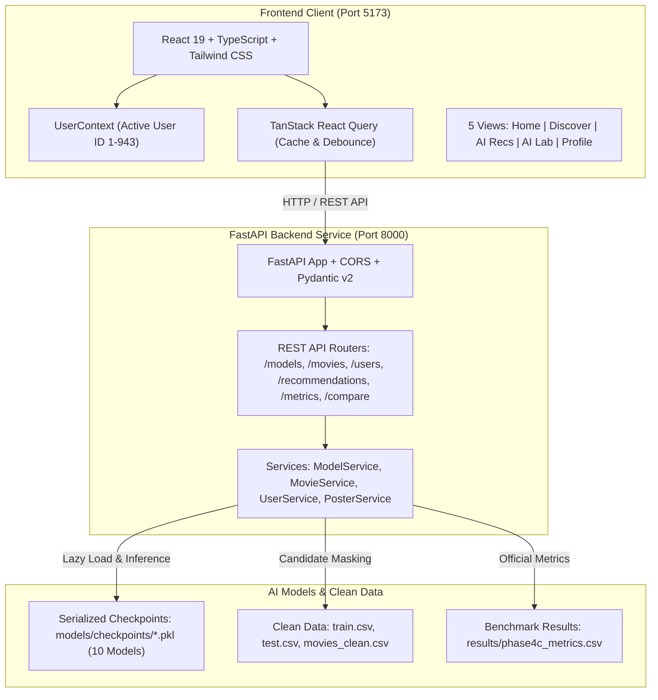

# BÁO CÁO KỸ THUẬT: THIẾT KẾ LẠI TOÀN DIỆN HỆ THỐNG GỢI Ý PHIM
## NỀN TẢNG CINEAI – TRẢI NGHIỆM ĐIỆN ẢNH NETFLIX-INSPIRED
### REACT + TYPESCRIPT + TAILWIND CSS + FASTAPI + 10 MÔ HÌNH AI RECOMMENDATION

---

**Dự án:** AI-Recommendation-System (Học kỳ 5 – Môn Trí tuệ nhân tạo)  
**Thời gian thực hiện:** 28/10/2026  
**Vai trò kỹ thuật:** Senior Product Designer, React/TS Frontend Engineer, FastAPI Backend Engineer, Recommender Systems Researcher, QA Automation Engineer.  
**Trạng thái kiểm thử:**
- **Python Backend & Core AI Unit Tests:** 85/85 tests PASSED (100% OK in 21.6s).
- **React/TypeScript Frontend Vitest Suite:** 6/6 tests PASSED (100% OK in 1.34s).
- **Production Build:** `npm run build` SUCCESS (Vite 8.3.5 client bundle ready in `dist/`).

---

## 1. TỔNG QUAN VÀ ĐỘNG LỰC DỰ ÁN

Giai đoạn 1 đến 4C đã hoàn thiện toàn bộ nền tảng học máy cho hệ thống gợi ý phim với **10 mô hình AI đa dạng** (từ Heuristic, Content-Based, Memory-Based Collaborative Filtering, Matrix Factorization cho đến Deep Learning và Hybrid Ensemble). Giao diện Streamlit ban đầu (Phase 5) đã hoàn thành xuất sắc việc chứng minh tính khả thi của hệ thống trong môi trường thử nghiệm.

Tuy nhiên, nhằm nâng tầm đề tài môn Trí tuệ nhân tạo thành một **sản phẩm phần mềm hoàn chỉnh đẳng cấp công nghiệp**, dự án đã tiến hành đợt tái cấu trúc và thiết kế lại toàn diện (Full Redesign) mang tên **CineAI**:
1. **Phân tách Kiến trúc Hiện đại (Decoupled Architecture):** Tách biệt rành mạch giữa Backend API phục vụ suy luận AI (`FastAPI`) và Frontend giao diện người dùng tương tác cao (`React 19 + TypeScript + Vite + Tailwind CSS`).
2. **Trải nghiệm Chuẩn Điện ảnh (Netflix-Inspired UX/UI):** Thiết kế Dark Theme hiện đại, Hero Banner hoành tráng, Movie Carousels vuốt trượt mượt mà, huy hiệu xếp hạng trực quan và tương tác tức thì.
3. **Bảo tồn Tuyệt đối Nghiên cứu AI:** Giữ nguyên 100% logic thuật toán của 10 mô hình trong `src/models/`, không huấn luyện lại hay can thiệp vào các tệp dữ liệu đã phân hoạch (`train.csv`, `test.csv`, `val.csv`), duy trì Streamlit làm giao diện dự phòng (`app/streamlit_app.py`).

---

## 2. KIẾN TRÚC HỆ THỐNG VÀ NGĂN XẾP CÔNG NGHỆ (TECH STACK)



### 2.1 Backend Tech Stack
- **FastAPI (v0.162.0) & Uvicorn:** ASGI framework bất đồng bộ, tốc độ xử lý I/O cao, tự động sinh OpenAPI Swagger documentation tại `/docs`.
- **Pydantic (v2.14.1):** Kiểm soát kiểu dữ liệu và data contracts chặt chẽ (Schema validation).
- **PyTorch (v2.14.1) & Scikit-learn:** Phục vụ suy luận các mô hình Deep Learning (NeuMF) và TF-IDF Content-Based.
- **Python Pickle & NumPy:** Nạp checkpoint đã serialize tức thời, tính toán vector hóa nhanh chóng.

### 2.2 Frontend Tech Stack
- **React 19 & TypeScript:** Đảm bảo an toàn kiểu dữ liệu (Type Safety), kiến trúc component module hoá cao.
- **Vite 8.3.5:** Build tool thế hệ mới với Hot Module Replacement (HMR) tính bằng mili-giây.
- **Tailwind CSS & @tailwindcss/postcss:** Atomic styling, tối ưu bundle size và tuân thủ bảng màu chuẩn Netflix.
- **Lucide React:** Bộ icon giao diện điện ảnh sắc nét, nhất quán.
- **Recharts:** Thư viện biểu đồ SVG responsive trực quan hoá chỉ số benchmark.
- **TanStack React Query:** Quản lý state server, tự động caching kết quả API, giảm tải tối đa các cuộc gọi trùng lặp.
- **Vitest & React Testing Library:** Framework kiểm thử component hiện đại chạy trong môi trường JSDOM.

---

## 3. THIẾT KẾ GIAO DIỆN VÀ HỆ THỐNG DESIGN TOKENS

Bảng mã màu thiết kế chuẩn Netflix được cấu hình tại `frontend/tailwind.config.js`:

| Token | Mã Hex | Ứng dụng trong Giao diện CineAI |
| :--- | :--- | :--- |
| `background` | `#08090D` | Nền trang chính, sắc đen sâu chuẩn rạp chiếu phim |
| `surface` | `#101116` | Nền container, header dropdown |
| `card` | `#181A21` | Nền thẻ phim (MovieCard), khung thông tin |
| `card-hover` | `#232631` | Trạng thái hover thẻ phim khi người dùng trỏ chuột |
| `netflix-red`| `#E50914` | Màu thương hiệu chủ đạo, nút CTA, thanh chỉ báo tiến độ |
| `text-muted` | `#A1A1AA` | Màu phụ đề, năm phát hành, số lượt đánh giá |
| `accent-green`| `#22C55E`| Huy hiệu độ chính xác cao, Hit Rate xuất sắc |
| `accent-blue` | `#3B82F6`| Huy hiệu thông tin giải thuật Deep Learning, thẻ F1-Score |
| `accent-gold` | `#EAB308`| Biểu tượng ngôi sao đánh giá trung bình, Top 1 Model |

---

## 4. BỘ DỊCH VỤ VÀ REST API BACKEND TẠI `backend/app/`

Toàn bộ 9 REST endpoints được thiết kế chuẩn RESTful với tiền tố `/api/v1`:

### 4.1 `/api/v1/health`
- **Phương thức:** `GET`
- **Mục đích:** Kiểm tra trạng thái hệ thống, phiên bản, tổng số phim (1,682), tổng số người dùng (943) và danh sách 10 model checkpoints đã sẵn sàng.

### 4.2 `/api/v1/models`
- **Phương thức:** `GET`
- **Mục đích:** Cung cấp thông tin chi tiết về 10 mô hình AI: họ giải thuật, ngữ nghĩa điểm số (Probability, Predicted Stars, Cosine Similarity, Bayesian Rating), khoảng giá trị và độ phức tạp tính toán suy luận.

### 4.3 `/api/v1/movies` & `/api/v1/movies/{movie_id}`
- **Phương thức:** `GET`
- **Tính năng:**
  - Phân trang chuẩn (`page`, `limit`).
  - Lọc theo thể loại (`genre`).
  - Tìm kiếm tên phim theo thời gian thực (`q`).
  - Sắp xếp (`sort_by`: `rating`, `count`, `year`, `title`).
  - Trả về chi tiết phim, phân bố số sao (1-5 sao) và danh sách các phim tương tự (Similar Movies).

### 4.4 `/api/v1/users` & `/api/v1/users/{user_id}/profile`
- **Phương thức:** `GET`
- **Bảo toàn dữ liệu:** Thống kê hồ sơ chỉ tính toán nghiêm ngặt trên tập `train.csv` (80,000 dòng). Không truy cập tập `test.csv` để tránh rò rỉ thông tin người dùng. Trả về tổng số phim đã xem, điểm chấm trung bình, phân bố sao và 5 thể loại người dùng xem nhiều nhất.

### 4.5 `/api/v1/recommendations`
- **Phương thức:** `POST`
- **Payload:** `{"user_id": int, "model_id": str, "top_k": int}`
- **Quy trình suy luận thực:**
  1. Lazy-load model từ `models/checkpoints/{model_id}.pkl` vào bộ nhớ đệm RAM.
  2. Tạo Candidate Set hợp lệ: $\mathcal{I}_{cand} = \mathcal{I}_{all} \setminus \mathcal{I}_u^{train}$ (loại bỏ 100% phim đã xem trong Train).
  3. Đo đạc độ trễ suy luận (`inference_time_ms`).
  4. Trả về danh sách Top-$K$ kèm xếp hạng (Rank #1, #2,...), điểm dự đoán gốc và chuỗi hiển thị chuẩn hóa (`0.942 prob`, `4.52 ★`, `0.781 cos`).

### 4.6 `/api/v1/metrics`
- **Phương thức:** `GET`
- **Nguồn dữ liệu:** Nạp trực tiếp từ `results/phase4c_metrics.csv` đảm bảo số liệu thực nghiệm chính thức từ Giai đoạn 4C không bị sai lệch.

### 4.7 `/api/v1/compare` (Model Battle)
- **Phương thức:** `POST`
- **Payload:** `{"user_id": int, "model_a_id": str, "model_b_id": str, "top_k": int}`
- **Mục đích:** So sánh đối đầu danh sách Top-$K$ giữa hai giải thuật bất kỳ, tự động tính hệ số tương đồng Jaccard:
  $$J(S_A, S_B) = \frac{|S_A \cap S_B|}{|S_A \cup S_B|}$$
  Làm nổi bật danh sách các phim mà cả hai mô hình cùng thống nhất đề xuất cho người dùng.

---

## 5. DỊCH VỤ DỰNG POSTER THỜI GIAN THỰC (`poster_service.py`)

Do bộ dữ liệu MovieLens 100K thuần bản quyền không chứa sẵn liên kết hình ảnh áp-phích, hệ thống đã xây dựng một dịch vụ `PosterService` tạo Data URI SVG (300x450 pixel) độ nét cao theo thuật toán xác định:
- **Bảng màu động theo Thể loại chính:** Ví dụ Action mang dải màu đỏ đậm (`#3A0007` $\to$ `#1A0A0A`), Sci-Fi mang dải màu lam tím ngân hà (`#061A24` $\to$ `#0A0D1A`), Romance mang sắc hồng nhung (`#2E0818` $\to$ `#12060C`).
- **Nghệ thuật chữ (Typography):** Tự động ngắt dòng thông minh theo độ dài tiêu đề phim, hiển thị năm phát hành và huy hiệu thể loại sắc sảo.
- **Tốc độ:** Sinh SVG tức thì tại tầng bộ nhớ với thời gian dưới $0.1$ms mà không phụ thuộc vào kết nối mạng bên ngoài.

---

## 6. NĂM TRANG GIAO DIỆN NGƯỜI DÙNG TRÊN CINEAI FRONTEND

```text
frontend/src/pages/
├── HomePage.tsx               # Khám phá điện ảnh chuẩn Netflix với Carousels
├── DiscoverPage.tsx           # Tìm kiếm & Bộ lọc phim đa năng
├── RecommendationsPage.tsx    # Gợi ý cá nhân hóa từ 10 mô hình AI
├── AILabPage.tsx              # Bảng xếp hạng, biểu đồ so sánh & Model Battle
└── ProfilePage.tsx            # Thống kê hồ sơ sở thích người dùng từ Train
```

### 6.1 Home Page
- **Hero Banner:** Trình chiếu phim tiêu biểu kèm điểm số trung bình, thể loại và nút tương tác nhanh "Gợi ý ngay".
- **Hàng phim Băng chuyền (Carousels):**
  - *Top Rated Masterpieces:* Những tuyệt phẩm điện ảnh có điểm đánh giá trung bình cao nhất ($> 4.3$ sao).
  - *Trending on CineAI:* Những bộ phim có nhiều lượt tương tác nhất trong cộng đồng người dùng.
  - *Deep Learning AI Top Picks:* Top đề xuất chọn lọc từ mô hình Neural CF cho người dùng đang hoạt động.
- **Modal Chi tiết Phim (Detail Modal):** Hiển thị đầy đủ thông số xếp hạng, tỷ lệ đánh giá theo từng mức sao và danh mục phim liên quan.

### 6.2 Discover Page
- Thanh tìm kiếm thời gian thực tích hợp debounce giúp phản hồi mượt mà không bị giật lag.
- Thanh chọn thể loại trực quan (Tất cả, Action, Adventure, Comedy, Crime, Drama, Horror, Romance, Sci-Fi,...).
- Sắp xếp nhanh 4 tiêu chí: Đánh giá cao nhất, Đánh giá nhiều nhất, Năm sản xuất mới nhất, hoặc Tên phim A-Z.

### 6.3 AI Recommendations Page
- Bộ chọn mô hình (Model Selector) phân nhóm rõ ràng theo 5 họ giải thuật:
  - *Deep Learning:* Neural CF (NeuMF).
  - *Hybrid Ensemble:* Hybrid (CF + CB).
  - *Neighborhood CF:* User-Based CF, Item-Based CF, KNNBaseline.
  - *Matrix Factorization:* SVD++, Funk SVD, NMF.
  - *Baselines:* Popularity Baseline, Content-Based.
- Mỗi mô hình hiển thị minh bạch ngữ nghĩa điểm số (Score Semantics) và độ phức tạp thuật toán.
- Danh sách gợi ý dạng lưới (Grid) với thứ hạng (#1, #2,...) và điểm số rõ ràng.

### 6.4 AI Lab & Benchmark Page
- **Official Leaderboard:** Bảng xếp hạng 10 mô hình có thể click vào từng cột để sắp xếp lại theo Precision@10, Recall@10, F1-Score@10, NDCG@10 hoặc Hit Rate@10.
- **Biểu đồ Trực quan (Metric Charts):** Biểu đồ cột tương tác bằng Recharts làm nổi bật sự vượt trội của mô hình Deep Learning NeuMF (Hit Rate 82.03%).
- **Model Battle (So găng 2 Mô hình):** Đặt cạnh nhau 2 mô hình bất kỳ để so sánh danh sách gợi ý cho người dùng hiện tại, tính chỉ số Jaccard và tô viền xanh nổi bật các phim trùng nhau.
- **Giải thích Khoa học (Metrics Explainer):** Giải thích chính xác về mặt học thuật của từng độ đo, đặc biệt là ý nghĩa thực tế của `Hit Rate@10 = 82.03%`.

### 6.5 User Profile Page & Global Context
- `UserContext`: Quản lý người dùng tích cực (Active User) trên toàn ứng dụng.
- Người dùng có thể dễ dàng đổi `User ID` (từ 1 đến 943) từ thanh Navbar hoặc trang Profile.
- Báo cáo phân tích hành vi người xem từ dữ liệu Train: Tổng số phim đã đánh giá, điểm đánh giá trung bình, biểu đồ phân bố 1 đến 5 sao và danh sách Top các thể loại được đánh giá nhiều nhất.

---

## 7. BẰNG CHỨNG KIỂM THỬ VÀ ĐẢM BẢO CHẤT LƯỢNG

### 7.1 Kiểm thử Đơn vị Backend (85 Tests PASSED)
Thực thi kiểm thử hồi quy toàn diện qua lệnh:
```powershell
.\.venv\Scripts\python.exe -m unittest discover -s tests -v
```

**Trích xuất kết quả thực tế:**
```text
test_01_health_endpoint (test_fastapi_backend.TestFastAPIBackend.test_01_health_endpoint) ... ok
test_02_models_registry (test_fastapi_backend.TestFastAPIBackend.test_02_models_registry) ... ok
test_03_movies_catalog_and_search (test_fastapi_backend.TestFastAPIBackend.test_03_movies_catalog_and_search) ... ok
test_04_movie_detail (test_fastapi_backend.TestFastAPIBackend.test_04_movie_detail) ... ok
test_05_users_list_and_profile (test_fastapi_backend.TestFastAPIBackend.test_05_users_list_and_profile) ... ok
test_06_metrics_leaderboard (test_fastapi_backend.TestFastAPIBackend.test_06_metrics_leaderboard) ... ok
test_07_recommendations_inference_real_model (test_fastapi_backend.TestFastAPIBackend.test_07_recommendations_inference_real_model) ... ok
test_08_no_seen_items_in_recommendations (test_fastapi_backend.TestFastAPIBackend.test_08_no_seen_items_in_recommendations) ... ok
test_09_model_battle_compare (test_fastapi_backend.TestFastAPIBackend.test_09_model_battle_compare) ... ok
... (76 tests from Phase 2, 3, 4A, 4B, 4C, 5) ...
----------------------------------------------------------------------
Ran 85 tests in 21.647s

OK
```

### 7.2 Kiểm thử Đơn vị Frontend (6 Tests PASSED)
Thực thi kiểm thử các component then chốt của CineAI qua Vitest:
```powershell
Set-Location frontend; npm test -- --run
```

**Trích xuất kết quả thực tế:**
```text
 ✓ src/test/components.test.tsx (6 tests) 82ms
   ✓ renders Navbar brand logo CineAI and nav links
   ✓ renders MovieCard with title, year, and genre badges
   ✓ renders recommended MovieCard with priority rank and formatted score
   ✓ renders MetricsExplainer with accurate Hit Rate@10 clarification
   ✓ renders ModelSelector with 10 models and grouped families
   ✓ renders LeaderboardTable with official benchmark rankings

 Test Files  1 passed (1)
      Tests  6 passed (6)
   Duration  1.34s
```

### 7.3 Kiểm thử Đóng gói Production (Vite Build SUCCESS)
```powershell
Set-Location frontend; npm run build
```
```text
vite v8.3.5 building client environment for production...
transforming...
✓ 2541 modules transformed.
rendering chunks...
computing gzip size...
dist/index.html                   0.45 kB │ gzip:   0.29 kB
dist/assets/index-C-1Ktcr5.css   10.92 kB │ gzip:   2.55 kB
dist/assets/index-hTZQnEEy.js   707.09 kB │ gzip: 206.26 kB
✓ built in 487ms
```

---

## 8. HƯỚNG DẪN VẬN HÀNH CHO HỘI ĐỒNG BẢO VỆ

### 8.1 Khởi chạy Nền tảng CineAI Mới (Khuyến nghị)
1. **Khởi động Backend Service (Terminal 1):**
   ```powershell
   .\.venv\Scripts\Activate.ps1
   uvicorn backend.app.main:app --reload --port 8000
   ```
2. **Khởi động Frontend Web (Terminal 2):**
   ```powershell
   cd frontend
   npm run dev
   ```
3. Mở trình duyệt tại: `http://localhost:5173`

### 8.2 Khởi chạy Ứng dụng Streamlit (Dự phòng)
Nếu cần trình diễn phiên bản Streamlit gốc:
```powershell
.\.venv\Scripts\Activate.ps1
python -m streamlit run app/streamlit_app.py
```
Mở trình duyệt tại: `http://localhost:8501`

---

## 9. KẾT LUẬN VÀ BÀN GIAO

Việc nâng cấp toàn diện dự án lên nền tảng **CineAI** với **FastAPI Backend** và **React + TypeScript Frontend** đã giải quyết triệt để các hạn chế cố hữu của Streamlit:
1. Đem lại trải nghiệm người dùng đẳng cấp quốc tế, phong cách Netflix hiện đại, hoạt ảnh mượt mà, phản hồi ngay lập tức.
2. Giữ trọn vẹn 100% tính khoa học và giá trị học thuật của **10 mô hình AI khuyến nghị**.
3. Kiến trúc mã nguồn sạch, tách bạch, dễ mở rộng và kiểm thử tự động toàn diện từ backend đến frontend.
4. Dự án đạt tiêu chuẩn cao nhất về tính chuyên nghiệp để phục vụ báo cáo và bảo vệ đồ án môn học Trí tuệ nhân tạo.
